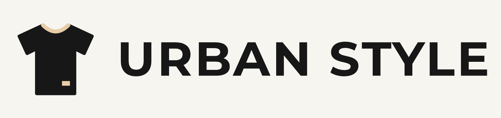
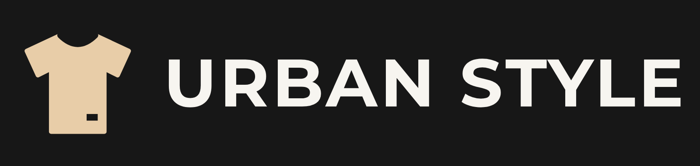

# Identidad de marca: Urban Style

> **Pregunta que responde este archivo:** ¿cómo nos vemos y cómo hablamos?

Este es el manual de identidad de Urban Style en formato Markdown. Todo lo que
se diseñe o programe tiene que respetar lo que dice acá. Los archivos del logo
y la referencia rápida de colores están en la carpeta [../marca/](../marca/paleta.md).

## Esencia

| Elemento | Definición |
| --- | --- |
| Nombre | Urban Style |
| Eslogan | “Tu estilo, tus reglas” |
| Rubro | Tienda online de ropa urbana |
| Misión | Acercar ropa urbana moderna, cómoda y combinable a través de una tienda online simple, donde elegir talle y color y hacer el pedido sea rápido. |
| Visión | Ser la tienda online de referencia para quienes arman su look diario con prendas urbanas, reconocida por lo clara y fácil de usar. |

### Significado del nombre y del eslogan

- **Urban** nombra el estilo: ropa pensada para la calle y el uso de todos los días.
- **Style** habla del estilo propio de cada persona, no de una moda impuesta.
- **“Tu estilo, tus reglas”** resume la idea de la marca: la tienda ofrece
  prendas combinables y el cliente decide cómo usarlas.

### Valores

- **Autenticidad:** cada persona arma su look sin seguir un molde.
- **Claridad:** talles, colores, precios y stock se muestran sin vueltas.
- **Comodidad:** prendas para usar todo el día y una compra sin pasos de más.
- **Cercanía:** se atiende de forma directa, por WhatsApp, con un trato amable.
- **Honestidad:** no se muestra como disponible lo que no hay en stock.

### Personalidad

Urbana, moderna, segura, cercana y directa. Si Urban Style fuera una persona,
sería alguien joven que se viste simple, combina bien y te recomienda una
prenda sin presionarte para que la compres.

### Público objetivo

Jóvenes y adultos que buscan prendas modernas, cómodas y combinables para el
uso diario, que compran desde el celular y prefieren resolver el pedido por
WhatsApp antes que completar un proceso de pago largo.

### Propuesta de valor

Una tienda online sencilla, moderna y adaptable a celulares y computadoras,
donde se puede explorar prendas, consultar talles y colores, revisar precios,
armar un carrito y enviar el pedido por WhatsApp en pocos pasos.

## Logo

El logo combina un **isotipo** (una remera minimalista) con el **nombre**
escrito en Montserrat Bold, en mayúsculas.



- La remera representa el producto principal y el rubro.
- El cuello y la etiqueta en Beige son el detalle de acento, igual que los
  botones del sitio.
- Las letras están convertidas a trazados: el logo se ve igual aunque la
  computadora no tenga instalada Montserrat.

### Versiones

| Versión | Archivos | Cuándo se usa |
| --- | --- | --- |
| Principal (fondos claros) | [logo.svg](../marca/logo.svg), [logo.png](../marca/logo.png) | Encabezado del sitio y documentos con fondo Marfil |
| Para fondos oscuros | [logo-oscuro.svg](../marca/logo-oscuro.svg), [logo-oscuro.png](../marca/logo-oscuro.png) | Pie de página y secciones con fondo Negro carbón |
| Isotipo | [isotipo.svg](../marca/isotipo.svg), [isotipo.png](../marca/isotipo.png) | Ícono del sitio (favicon) y espacios cuadrados |



### Reglas del logo

- **Área de seguridad:** dejar alrededor un espacio libre igual a la mitad del
  alto de la remera del isotipo.
- **Tamaño mínimo en pantalla:** 40 px de alto para el logo completo (así las
  letras no bajan de 11 px) y 16 px para el isotipo.
- **Formato:** usar SVG en el sitio web y PNG en documentos.

## Colores

La paleta oficial tiene cuatro colores. **No se agregan colores nuevos.**

| Nombre | HEX | Uso | Contraste |
| --- | --- | --- | --- |
| Negro carbón | `#171717` | Color principal: títulos, textos, logo, bordes y encabezados | 16,45:1 sobre Marfil y 11,72:1 sobre Beige. Sirve para cualquier texto. |
| Beige | `#E8CDA8` | Color de acento: botones, detalles y llamadas a la acción | Siempre lleva texto Negro carbón encima (11,72:1). Nunca se usa como texto sobre Marfil (1,40:1). |
| Marfil | `#F7F5F0` | Fondo principal del sitio | Como texto solo va sobre Negro carbón (16,45:1). |
| Gris medio | `#777777` | Información complementaria e inactiva | 4,11:1 sobre Marfil: alcanza para texto grande y componentes, no para texto chico. |

### Reglas de contraste

Se toma como referencia el nivel AA de WCAG 2.2: **4,5:1** para texto normal y
**3:1** para texto grande (desde 24 px, o desde 18,66 px en negrita) y para
componentes de la interfaz.

1. El texto de lectura (párrafos, descripciones, precios, formularios) va
   siempre en Negro carbón sobre Marfil o sobre Beige.
2. Sobre Negro carbón, el texto va en Marfil o en Beige.
3. El Gris medio se usa para información complementaria **solo en tamaño
   grande** (24 px o más), y para líneas divisorias, íconos y elementos
   inactivos. Un texto secundario chico va en Negro carbón y se diferencia por
   el tamaño, no por el color.
4. El Beige nunca se usa como color de texto sobre Marfil.
5. La única transparencia permitida es Negro carbón al 60 % sobre la foto del
   banner, para asegurar que el texto se lea.

> **Decisión tomada:** el Gris medio estaba pensado para textos secundarios,
> pero al calcular el contraste (4,11:1) no alcanza el mínimo para letra chica.
> Por eso se limitó su uso en lugar de cambiar el color de la paleta.

### Colores que no son de la marca

Los colores de las prendas (por ejemplo, la muestra de color “Azul marino” de
un producto) son **datos del catálogo**, no parte de la identidad. Se muestran
solo dentro del selector y del filtro de color.

Tampoco se usan rojo, verde ni amarillo para avisos: los errores y las
confirmaciones se distinguen con ícono, texto y borde (ver
[06-DISENO-UI.md](06-DISENO-UI.md)).

## Tipografías

| Tipografía | Peso | Uso | Motivo |
| --- | --- | --- | --- |
| Montserrat | Bold (700) | Títulos, encabezados, botones, precios y nombre de la marca | Formas geométricas y gruesas, con buena lectura en tamaños grandes. Su diseñadora, Julieta Ulanovsky, se inspiró en los carteles del barrio porteño de Montserrat: es una tipografía de origen urbano |
| Inter | Regular (400) | Párrafos, descripciones, formularios y textos generales | Diseñada para pantallas: se lee bien en tamaños chicos y en celulares |

- Las dos son tipografías libres (licencia SIL Open Font License) y están
  disponibles en Google Fonts.
- No se usan otros pesos ni otras familias. La jerarquía se logra con el
  tamaño, las mayúsculas y el espaciado.

### Escala de tamaños

| Elemento | Tipografía | Celular | Computadora |
| --- | --- | --- | --- |
| Título principal (H1) | Montserrat Bold | 32 px | 40 px |
| Título de sección (H2) | Montserrat Bold | 24 px | 28 px |
| Subtítulo (H3) | Montserrat Bold | 18 px | 20 px |
| Texto general | Inter Regular | 16 px | 16 px |
| Texto chico | Inter Regular | 14 px | 14 px |
| Botones | Montserrat Bold, mayúsculas | 14 px | 14 px |

## Tono de comunicación

Juvenil, moderno, cercano, claro y directo. Se habla de **vos**, con frases
cortas y sin palabras técnicas.

| Situación | Así sí | Así no |
| --- | --- | --- |
| Portada | “Encontrá tu próximo look y combiná las prendas a tu manera.” | “Bienvenido a nuestra plataforma de comercio electrónico.” |
| Botón | “Agregar al carrito” | “Proceder con la incorporación del artículo” |
| Sin stock | “Este talle se agotó. Probá con otro color o talle.” | “ERROR: stock insuficiente.” |
| Carrito vacío | “Tu carrito está vacío. Mirá el catálogo y armá tu look.” | “No se registran ítems.” |
| Pedido listo | “¡Listo! Tu pedido está armado. Envialo por WhatsApp para confirmarlo.” | “Operación exitosa.” |

Reglas del tono:

- Hablar de vos: “elegí”, “sumá”, “escribinos”.
- Decir qué pasó y qué se puede hacer, sobre todo en los errores.
- No prometer lo que el sitio no hace (envíos, pagos o plazos).
- No usar mayúsculas sostenidas en frases completas ni signos repetidos.

## Uso correcto e incorrecto

### Correcto

- Usar los archivos de la carpeta `marca/` sin modificarlos.
- Usar el logo principal sobre Marfil y el logo oscuro sobre Negro carbón.
- Usar siempre las variables CSS de este archivo para colores y fuentes.
- Poner texto Negro carbón sobre los botones Beige.

### Incorrecto

- Deformar, rotar, recortar o recolorear el logo.
- Agregarle sombras, degradados, contornos o efectos.
- Reescribir el nombre con otra tipografía.
- Poner el logo principal sobre fondos oscuros o sobre fotos sin contraste.
- Escribir colores HEX a mano en el código en lugar de usar las variables.
- Sumar colores, tipografías o pesos que no estén en este manual.

## Variables CSS

Se copian tal cual en `app/globals.css`. El código usa **siempre** estas
variables. Si la marca cambia un color, se edita una sola línea.

```css
:root {
  /* Colores */
  --color-principal: #171717;  /* Negro carbón */
  --color-acento: #E8CDA8;     /* Beige */
  --color-fondo: #F7F5F0;      /* Marfil */
  --color-secundario: #777777; /* Gris medio */

  /* Tipografías */
  --fuente-titulos: "Montserrat", "Segoe UI", Arial, sans-serif;
  --fuente-textos: "Inter", "Segoe UI", Arial, sans-serif;
  --peso-titulos: 700;
  --peso-textos: 400;

  /* Formas y espacios */
  --radio-borde: 2px;
  --borde: 2px solid var(--color-principal);
  --espacio-1: 4px;
  --espacio-2: 8px;
  --espacio-3: 16px;
  --espacio-4: 24px;
  --espacio-5: 32px;
  --espacio-6: 48px;
}

h1,
h2,
h3 {
  font-family: var(--fuente-titulos);
  font-weight: var(--peso-titulos);
  color: var(--color-principal);
}

body {
  font-family: var(--fuente-textos);
  font-weight: var(--peso-textos);
  color: var(--color-principal);
  background: var(--color-fondo);
}
```

## Relación con otros archivos

- La aplicación de la marca en cada pantalla está en [06-DISENO-UI.md](06-DISENO-UI.md).
- Los textos para buscadores respetan este tono: [09-SEO.md](09-SEO.md).
- El índice general es [../AGENTS.md](../AGENTS.md).
